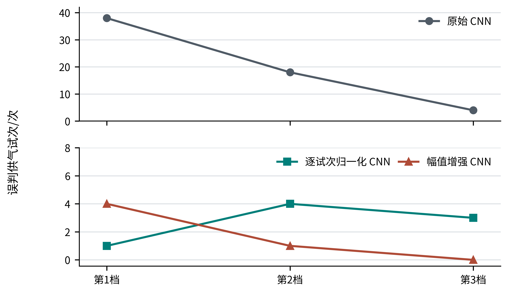
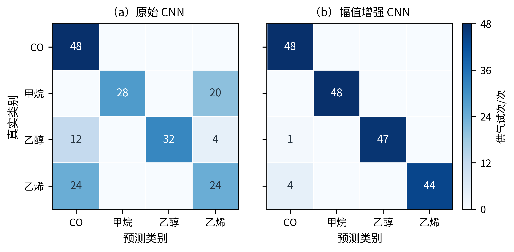

# 基于响应幅值增强的气敏阵列跨设备低浓度气体辨识

**摘　要：** 针对气敏阵列在更换设备且测试气体浓度低于训练范围时辨识性能下降的问题，研究响应幅值增强与轻量一维卷积网络相结合的方法。以五台八通道气敏阵列采集的一氧化碳、甲烷、乙醇和乙烯单一气体数据为对象，提取供气前基线与供气后响应差值，仅对其他设备的较高浓度训练信号进行幅值缩放。采用整台设备留出、高浓度档训练与低浓度档测试的评价方式，对192次独立供气试次进行汇总。实验表明，未增强卷积网络的宏平均F1为0.691，幅值增强后达到0.974，正确辨识187次，一氧化碳48次全部辨识正确；同试次归一化卷积网络达到0.959，等数量的平滑噪声和时间平移增强分别达到0.706和0.691。结果说明，在该公开数据的跨设备低浓度任务中，针对响应减弱的训练增强较所测试的普通增强更有效，但不同处理方式在一氧化碳误报与漏报之间存在取舍。

**关键词：** 气敏阵列；跨设备辨识；低浓度气体；数据增强；一维卷积神经网络

## 0　引言

焦化生产相关场景存在一氧化碳、甲烷等气体监测需求。基于金属氧化物传感器阵列的气体辨识，可以利用多个通道对同一气体的不同响应形成特征。然而，即使传感器阵列设计相同，不同设备的响应也可能存在差异；当训练阶段主要获得较高浓度数据，而新设备需要辨识较低浓度气体时，设备变化与浓度变化会同时影响模型。本文研究的问题是：**只使用其他设备的较高浓度样本训练，能否辨识一台未参与训练的设备上的较低浓度气体？**

国内研究已将一维卷积网络用于气体识别：李鹏等以甲烷、CO、乙烯及两种混合物为对象进行辨识[5]，吴青云等在CO与乙烯混合气公开数据上比较卷积网络和BP网络[6]，谭光韬等研究了气体传感器阵列的混合气检测[8]。俞凌伟等甚至在本文使用的Twin数据集上报告了气体识别结果[7]。这些工作说明“使用CNN识别气体”以及“在Twin数据集上达到较高准确率”都不是本文的创新点；其发表的准确率也不能在训练、测试划分不同的情况下与本文直接比较。已有工作还研究了气敏阵列之间的校准传递与漂移校正[1]，数据增强也已用于气敏传感器建模[3]。针对**训练设备与测试设备不同、训练浓度范围高于测试浓度范围**的联合任务，本文将增强限制在源设备训练数据上，比较不增强、逐试次归一化、幅值增强及两种普通增强，并以相同任务下的支持向量机作为模型对照。研究重点是明确这种简洁处理在何种评价条件下有效，以及它带来的误判取舍。

## 1　数据与辨识任务

### 1.1　数据来源

采用UCI机器学习库公开的Twin gas sensor arrays数据集[4]。该数据由五台结构相近的气敏阵列设备采集，每台设备含八个金属氧化物传感通道。数据包含一氧化碳（CO）、甲烷（Me）、乙醇（Ea）和乙烯（Ey）四类**分别供气**的实验。每类气体设置十个浓度档，每个原始文本文件对应一次完整供气试次。经文件名、设备编号、气体标签和试次完整性核对，共有640次供气试次；它们不是640个时间点，也不是混合气样本。

CO与甲烷的前三档浓度分别为25、50、75 ppm，第4—10档为100—250 ppm；乙醇与乙烯的前三档为12.5、25、37.5 ppm，第4—10档为50—125 ppm。不同气体使用不同的实际浓度范围，因此本文采用“档位”定义高低浓度划分，不把四种气体的绝对ppm值视为同一个阈值。

### 1.2　整台设备留出与计分单位

轮流指定一台设备作为目标设备。每轮仅使用其余四台设备的第4—10档试次训练，使用目标设备的第1—3档试次测试；目标设备的高浓度数据与其他设备的低浓度数据均不进入该轮模型训练或测试。预处理所需的跨试次统计量仅在当轮训练数据上拟合。这样，共得到五轮留出测试，192个互不重复的完整供气文件各计分一次，四类气体各48次。各设备的测试量见表1。

**表1　整台设备留出的低浓度测试试次**

| 留出设备 | 1 | 2 | 3 | 4 | 5 | 合计 |
|---|---:|---:|---:|---:|---:|---:|
| 测试试次/次 | 48 | 48 | 48 | 24 | 24 | 192 |

本文报告按192次测试结果汇总的四类宏平均F1、正确次数和CO识别情况，同时列出最差设备表现，避免仅用总体准确率掩盖设备差异。五轮在训练和测试时相互独立；汇总计分不将同一物理试次重复计算。

## 2　响应幅值增强与一维卷积辨识方法

### 2.1　八通道响应时序构造

对于一次供气试次的第$j$个传感通道，以25—45 s内对数电阻的中位数作为供气前基线，以50—90 s内的信号描述供气后的早期响应。将后者按相邻2 s聚合，得到长度为20、通道数为8的响应矩阵。其元素表示为

$$
x_j(t)=\operatorname{median}_{u\in I_t}\log R_j(u)
-\operatorname{median}_{25\leq u<45}\log R_j(u),
\qquad j=1,\ldots,8,\quad t=1,\ldots,20, \tag{1}
$$

式中，$R_j$为第$j$个通道的电阻，$I_t$是供气后50—90 s内第$t$个相邻2 s窗口。使用对数差值能够消除单次试次中较大的一部分静态基线差异，而保留供气后的通道响应形状。输入窗口及聚合规则对所有模型保持一致。

### 2.2　只对训练试次进行幅值增强

低浓度试次的响应幅度可能小于较高浓度试次。为让模型在训练时接触减弱的响应，对每个源设备高浓度训练矩阵$X$生成

$$
X^{(a)}=aX,\qquad a\in\{0.5,\,0.75,\,1.0\}. \tag{2}
$$

缩放对同一试次的全部时间点和八个通道使用相同系数，保持通道间相对关系和时间变化趋势，不改变其气体类别。增强后一个原始试次对应三份训练输入，但仍只有**一次真实供气**。式（2）只是对响应减弱的经验近似，并不意味着缩放后的曲线等同于某个确定ppm浓度的实测信号。目标设备的试次不参与增强，也不使用目标设备的类别标签进行校正。

### 2.3　轻量一维卷积网络与对照设置

一维卷积网络接收$20\times8$的响应矩阵，采用16个时间长度为3的卷积核提取局部时序特征，经过ReLU激活后，将卷积响应的前、后两段分别做时间均值池化，再接四类输出层。训练使用固定的参数惩罚与迭代上限；通道标准化参数仅由源设备训练样本计算。网络结构和测试窗口在增强与不增强两组之间保持相同。

为判断效果是否只来自训练样本数量增加，实验另外比较相同输入上的核支持向量机（SVM）：不增强与三档幅值增强分别训练。同时设置逐试次响应均方根（RMS）归一化作为强对照，它将每条响应按自身幅度缩放，再分别训练CNN与SVM。各对照使用相同的设备划分和测试文件；逐试次归一化使用当前试次自身的无标签信号，不使用目标设备的气体标签。本文比较的是同一任务中的处理方法，而非以不同论文的准确率直接排定算法优劣。

进一步设置两个**与幅值增强具有相同训练输入份数**的普通增强对照：第一种给每条训练响应加入经过时间平滑的随机扰动，并把每条扰动的整体大小匹配到0.5倍及0.25倍原响应范数，再保留一份原始响应；第二种把响应沿时间轴分别左移和右移一个采样窗口，边界值复制补齐，并保留原始响应。三个增强组均使用同一CNN结构、训练设备和随机初始化。对照及失败判据在该次实验运行前写入代码：若任一普通增强同时达到不低于幅值增强的宏平均F1和CO正确数，且CO误报不更多，则不能声称本实验中幅值增强有特别优势。这是对已反复查看的数据所做的**回顾性机制对照**，不是独立盲测。

另设目标设备标定预算对照，用以判断少量目标设备标注是否改变上述排序。对每台留出设备，从第4—10浓度档中按四类各抽取5次实际供气，共20次，供模型训练；低三档测试试次与这20次互不重叠。分别以随机种子21、37、59重复抽取，并比较只用源设备三档幅值增强、源设备加20次目标设备试次但不增强、源设备加20次目标设备试次再增强，以及仅用20次目标设备试次并增强的核SVM。增加20次试次后，标准化器重新在对应模型的训练样本上拟合。三个抽样仅用于观察标定试次选择的敏感性，不视作三个独立设备。

## 3　实验结果与分析

### 3.1　四类辨识结果

表2给出五轮留出设备测试汇总结果。正确次数的分母均为192次独立低浓度供气试次。对于CO，分别报告真实CO的正确辨识数以及其他气体误判为CO的次数。

**表2　不同处理方法的跨设备低浓度辨识结果**

| 模型及训练处理 | 宏平均F1 | 正确试次 | 真实CO辨识正确 | 非CO误判为CO |
|---|---:|---:|---:|---:|
| CNN，不增强 | 0.691 | 132/192 | 48/48 | 36/144 |
| CNN，逐试次RMS归一化 | 0.959 | 184/192 | 42/48 | 1/144 |
| CNN，三档幅值增强 | **0.974** | **187/192** | **48/48** | 5/144 |
| SVM，不增强 | 0.736 | 141/192 | 48/48 | 24/144 |
| SVM，逐试次RMS归一化 | 0.918 | 176/192 | 40/48 | 5/144 |
| SVM，三档幅值增强 | 0.963 | 185/192 | 48/48 | 3/144 |
| CNN，等份数平滑噪声增强 | 0.706 | 135/192 | 48/48 | 33/144 |
| CNN，等份数时间平移增强 | 0.691 | 132/192 | 48/48 | 36/144 |

未增强CNN面对设备与浓度同时变化时，四类宏平均F1为0.691，幅值增强后提升至0.974；同样的增强用于SVM时，其F1由0.736提升至0.963。这表明提升并非只发生在卷积网络上。逐试次归一化CNN已达到0.959，距增强CNN仅差3个正确试次，说明单纯改变响应幅度的办法并非在所有模型与评价指标上都具有大幅优势。尤其在非CO误判为CO方面，归一化CNN为1次，而增强CNN为5次；但归一化CNN把6次真实CO判成其他气体。两种处理方式体现了不同的漏报与误报取舍。

图1按目标设备的低浓度档位汇总逐试次预测。每档有64次独立供气，四类气体各16次。三档分别是各气体自身的浓度顺序，不表示四类气体的绝对ppm相同。未增强CNN在最低档误判38次，到第3档降为4次；增强后分别误判4、1、0次。逐试次归一化在三档分别误判1、4、3次，显示其与增强方法有不同的误判取舍。

{width=14.5cm}

**图1　低浓度档位上的误判次数。** 每个点对应64次完整供气试次；上下两幅采用明确标出的不同纵轴量程，以便分别观察未增强CNN的大量误判和两种处理方式的少量误判。曲线仅连接有序的第1—3档实测计数，不代表连续浓度范围的拟合关系。未增强基线来自160次优化上限的原始实验，另外两组采用400次上限收敛复核。

**表3　五台留出设备的CNN宏平均F1**

| 留出设备 | 测试供气/次 | 未增强CNN | 逐试次归一化CNN | 幅值增强CNN |
|---|---:|---:|---:|---:|
| 1 | 48 | 0.679 | 0.830 | 0.939 |
| 2 | 48 | 0.576 | **1.000** | 0.958 |
| 3 | 48 | 0.794 | 1.000 | 1.000 |
| 4 | 24 | 0.873 | 1.000 | 1.000 |
| 5 | 24 | 0.424 | 1.000 | 1.000 |

表3保留设备2这一局部反例：归一化CNN高于幅值增强CNN。设备4、5各仅有24次测试，不能把五台设备当作相同试次数的五次独立验证。

### 3.2　增强CNN的逐类错误与设备差异

图2对照未增强和三档幅值增强CNN的逐类错误。每个矩阵的行是真实类别、列是预测类别，四类气体各有48次测试。

{width=14.5cm}

**图2　未增强与幅值增强CNN的四类混淆矩阵（次）。** 两图使用相同色阶，单元格是完整供气试次数，主对角线表示正确辨识。未增强CNN正确132次，增强CNN正确187次。增强CNN仍将1次乙醇和4次乙烯误判为CO。

模型对CO和甲烷分别正确辨识48次，乙醇47次，乙烯44次。五次错误均为乙醇或乙烯被误判成CO，因此CO召回率为48/48，CO预测精确率为48/53。增强CNN的五台留出设备的宏平均F1分别约为0.939、0.958、1.000、1.000和1.000，最低的是设备1。这组结果不能仅概括为“CO识别率100%”，因为CO误报仍然存在。

强对照也存在局部优势：留出设备2时，逐试次归一化CNN的设备级宏平均F1为1.000，而增强CNN约为0.958。除此之外，早期四档幅值设置$\{0.25,0.5,0.75,1\}$在同一批测试试次上得到更高的四类宏平均F1（0.984），却将2次真实CO判错。本文选用三档结果来讨论CO漏报与总体四类辨识的取舍，不能把这种查看结果后的选择描述为独立盲测获得的最优超参数。

### 3.3　普通增强与幅值增强的对照

在相同源设备训练试次、相同测试文件和每条训练试次均为三份输入的条件下，平滑噪声增强得到0.706的宏平均F1，时间平移增强得到0.691，分别比幅值增强的0.974低0.268和0.283。逐试次配对核查显示，幅值增强相对平滑噪声增强纠正52次且未新增错误，相对时间平移增强纠正55次且未新增错误。因而，本数据上的提升不能单用“训练输入复制了三份”解释；本实验选取的两种普通扰动也不能替代针对低响应幅值的训练增强。此对照只检验两种具体普通增强及其固定强度，不推出幅值增强优于所有数据增强方法。

### 3.4　目标设备20次标定与训练稳定性

表4列出三次目标设备高浓度标定样本抽取后的结果范围。各方法每次都汇总同一批192个目标设备低浓度试次；“20次”表示每台目标设备额外提供20次有标签的高浓度真实供气，不计入测试分母。

**表4　目标设备标定预算对照（三次抽样范围）**

| 核SVM的训练数据 | 宏平均F1 | 正确试次 | 真实CO辨识正确 | 非CO误判为CO |
|---|---:|---:|---:|---:|
| 源设备高浓度＋三档增强，无目标标注 | 0.963 | 185/192 | 48/48 | 3/144 |
| 源设备高浓度＋目标设备20次，不增强 | 0.739—0.745 | 142—143/192 | 48/48 | 25—27/144 |
| 源设备高浓度＋目标设备20次＋三档增强 | 0.968—0.990 | 186—190/192 | 48/48 | 2—3/144 |
| 仅目标设备20次＋三档增强 | 0.876—0.943 | 168—181/192 | 46—47/48 | 5—7/144 |

这项对照给出两个边界。第一，少量目标设备高浓度标注不能自动代替针对低响应的增强：源设备加目标设备20次但不增强时，宏平均F1仍不足0.75。第二，**不能宣称无标定方法优于使用20次标定的方法**，因为给源设备训练加入这20次标注并继续增强后，在三次抽样中都比无标定增强SVM多辨识正确1—5次。该结果更适合支持“幅值增强在无目标标注和少量目标标注时均有作用”，而非证明不需要标定。

为核对卷积模型是否依赖一次初始化，将优化上限统一设为400，并对固定三档增强CNN使用2023—2027五个随机种子。五次训练的所有设备折均在上限前收敛，五次均得到相同的187/192、宏平均F1 0.974、CO 48/48及非CO误判为CO 5/144。这说明本文的CNN结果对这一组初始化不敏感，但增强CNN相对增强SVM只多正确2次，不能据此声称卷积结构显著优于核SVM。

### 3.5　结果讨论

对数基线扣除后，训练信号的幅度仍携带设备与浓度的共同变化。直接用较高浓度训练，模型可能依赖训练区间内的响应强弱；训练阶段加入较弱幅值的同类曲线，使分类边界不必只围绕原始高浓度响应建立。逐试次归一化则更彻底地削弱幅值信息，虽然也提高了总体辨识结果，但本实验中对真实CO产生了6次漏判。平滑噪声和短时平移未解决训练区间与测试区间的主要幅值落差。以上是与实验结果相符的机制解释，并不能据此证明所有设备、全部浓度区间都遵循同一种线性响应规律。

与需要目标设备配对标定样本的校准传递方法[1]相比，本实验设置不提供目标设备的气体标注样本，适合研究“新设备尚未配气标定”时的分类问题。不过本方法并没有直接校正设备之间的物理参数，也不预测气体浓度数值。公开数据含五台设备，且三档幅值因素和模型主张是在探索该数据的过程中逐步确定的；现有结果应作为这五台设备上的回顾性实验证据，不应称为独立数据盲测。针对原CNN部分折触及160次优化上限的问题，将三档幅值增强和逐试次归一化CNN的上限统一提高到400次，其余设置及192个测试文件不变；两组五折均在上限前收敛，结果分别仍为187/192、宏平均F1 0.974和184/192、宏平均F1 0.959，真实CO分别正确48/48和42/48。该核查排除了原迭代上限导致两者排序颠倒的疑虑，但尚需新设备和新数据进一步验证。

## 4　结语

围绕其他设备较高浓度数据训练、新设备较低浓度气体辨识这一问题，本文在八通道气敏时序上采用训练阶段的响应幅值增强，并与轻量一维卷积网络结合。在五台设备轮流留出的192次低浓度单一气体试次中，四类宏平均F1由未增强CNN的0.691提升至0.974，正确辨识187次；真实CO辨识48/48，同时出现5次非CO误报为CO。等份数噪声与时间平移对照均未达到幅值增强的结果；逐试次归一化CNN和增强SVM则取得接近的结果。本文的贡献定位于**特定跨设备低浓度任务中的方法适配与对照验证**，而非发明全新的卷积结构或通用数据增强算法。后续若获得新的同类设备试次，应在保持处理规则不变的条件下进一步检验其适用范围。

## 参考文献

[1] FONOLLOSA J, FERNÁNDEZ L, GUTIÉRREZ-GÁLVEZ A, et al. Calibration transfer and drift counteraction in chemical sensor arrays using Direct Standardization[J]. *Sensors and Actuators B: Chemical*, 2016, 236: 1044-1053. DOI: [10.1016/j.snb.2016.05.089](https://doi.org/10.1016/j.snb.2016.05.089).

[2] ZHOU Y, HENG Y, ZHU J, et al. Enhanced Gas Recognition of Electronic Nose Using 1-D Convolutional Neural Network With Savitzky-Golay Filter[J]. *IEEE Sensors Journal*, 2024, 24(7): 10769-10778. DOI: [10.1109/JSEN.2024.3363698](https://doi.org/10.1109/JSEN.2024.3363698).

[3] ZHANG S, et al. Strategy to expedite gas sensor calibration based on cyclic temperature operation and data augmentation[J]. *Sensors and Actuators B: Chemical*, 2024. DOI: [10.1016/j.snb.2024.136060](https://doi.org/10.1016/j.snb.2024.136060).

[4] FONOLLOSA J. Twin gas sensor arrays[DS]. UCI Machine Learning Repository, 2016. DOI: [10.24432/C5MW3K](https://doi.org/10.24432/C5MW3K).

[5] 李鹏, 徐永凯, 杨佳康, 等. 基于一维卷积神经网络的气体识别方法研究[J]. 电子器件, 2022, 45(3): 645-650. DOI: [10.3969/j.issn.1005-9490.2022.03.024](https://doi.org/10.3969/j.issn.1005-9490.2022.03.024).

[6] 吴青云, 邹亚囡, 史雪莹. 基于卷积神经网络的电子鼻分类识别[J]. 吉林化工学院学报, 2022, 39(11): 38-41. DOI: [10.16039/j.cnki.cn22-1249.2022.11.008](https://doi.org/10.16039/j.cnki.cn22-1249.2022.11.008).

[7] 俞凌伟, 杨孟平, 杨海, 等. 基于膨胀因果卷积和注意力机制的气体识别方法[J]. 华东理工大学学报(自然科学版), 2025, 51(3): 380-390. DOI: [10.14135/j.cnki.1006-3080.20240614001](https://doi.org/10.14135/j.cnki.1006-3080.20240614001).

[8] 谭光韬, 张文文, 王磊. 气体传感器阵列混合气体检测算法研究[J]. 电子测量与仪器学报, 2020, 34(7): 95-102. DOI: [10.13382/j.jemi.B1902505](https://doi.org/10.13382/j.jemi.B1902505).
