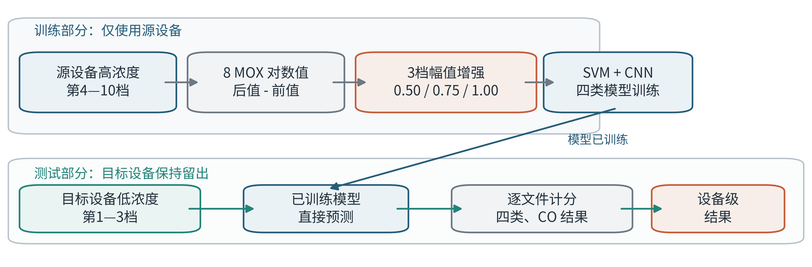
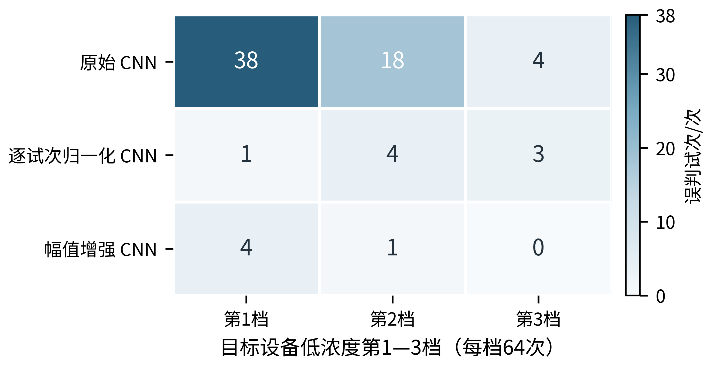
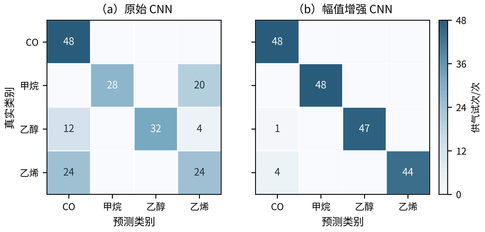
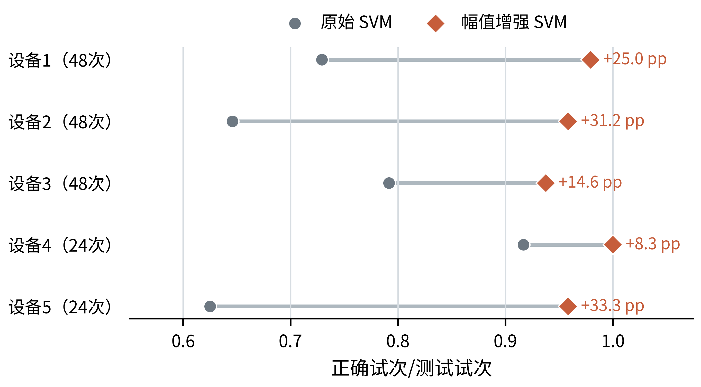

# 面向山西焦化园区气体监测的跨设备低浓度气体辨识方法

**摘　要：** 针对气敏阵列在设备更换且待测浓度低于训练范围时辨识性能下降的问题，提出一种面向源设备训练数据的响应幅值增强方法。该方法先从八通道金属氧化物传感器时序中提取供气前后的对数响应差值，再以0.50、0.75和1.00三个系数缩放完整响应矩阵，在保持通道相对关系和时序形状的同时模拟响应减弱。采用五台同构设备采集的一氧化碳、甲烷、乙醇和乙烯单一气体数据，按“其他设备第4—10浓度档训练、留出设备第1—3浓度档测试”构造跨设备高浓度到低浓度任务，以192个不重复完整供气文件为计分单位。实验结果表明，幅值增强使支持向量机宏平均F1由0.736提高到0.963，使轻量一维卷积神经网络宏平均F1由0.691提高到0.974；后者正确辨识187/192次，一氧化碳召回48/48，非一氧化碳误报为一氧化碳5/144。五台留出设备上的SVM正确率均提高，等数量平滑噪声和时间平移增强未获得相同效果。另在两套公开数据上进行压力测试：六类气体跨批次任务支持幅值机制的相对改善，而低浓度一氧化碳跨传感器任务未达到预设绝对性能要求，表明该方法并非无条件适用。研究为山西焦化园区气体监测设备更换和低浓度识别阶段的算法设计提供了一种计算开销较低的技术方案。

**关键词：** 山西焦化园区；气敏阵列；跨设备辨识；低浓度气体；数据增强；一维卷积神经网络

## 0　引言

焦化生产过程涉及煤气净化、焦炉加热、化产回收等环节，气体检测设备需要在复杂工况下长期运行。《焦化安全规范》对焦化生产安全提出了系统要求[1]，《作业场所环境气体检测报警仪器 通用技术要求》进一步规定了气体检测报警仪器的性能与试验要求[2]。在工程部署中，同型号气敏阵列之间仍可能存在器件离散性、老化和环境差异；新设备投入使用时，能够获得的标定数据又往往有限。如果模型主要见过其他设备采集的较高浓度样本，而实际待测信号来自一台新设备且浓度更低，设备差异和浓度差异会同时造成输入分布偏移。

电子鼻通常利用多个传感通道形成响应模式，再由统计学习或深度学习完成气体分类[3]。已有研究主要从三方面提高跨域能力：一是利用配对标准样本进行直接标准化或校准传递[4]；二是通过领域对抗、元学习等方法提取漂移不敏感特征[5-6]；三是使用全局标定、迁移学习或数据增强减少新设备标定成本[7-8]。国内研究也已将一维卷积网络用于多气体及混合气识别[14-17]，并在仿生嗅觉识别、浓度估计和多通道MOS检测系统方面开展研究[18-19]。因此，“使用CNN识别气体”或“在公开数据上获得较高准确率”本身并不足以构成本文创新。

本文关注更具体的工程问题：**仅使用其他设备的较高浓度数据训练，在不使用目标设备气体标签的条件下，辨识目标设备的较低浓度气体。** 与需要目标设备配对标定的校准传递不同，本文把浓度降低首先视为完整响应幅度减弱，在源设备训练阶段进行三档幅值缩放；同时用SVM与轻量CNN验证该处理是否依赖特定分类器。主要工作如下：

1. 建立整台设备留出且训练、测试浓度区间不重叠的评价协议，以完整供气文件为计分单位，避免把同一试次的时间点拆分到训练集和测试集；
2. 构造保持时序形状与通道相对关系的源端幅值增强，并与逐试次归一化、等份数平滑噪声、时间平移及少量目标设备标定进行同任务对照；
3. 报告设备级结果、CO漏报与误报、局部反例和两套外部压力测试，明确方法的适用范围，而不只给出总体准确率。

## 1　相关工作与问题定位

气敏阵列的域偏移可能来自设备离散性、传感器漂移、温湿度变化和气体浓度范围改变。直接标准化通过源、目标设备上的配对传递样本建立映射，可有效减小阵列之间的差异[4]；领域对抗网络通过域判别器学习域不变特征[5]；MDFE-Net则将双分支特征提取和元学习用于漂移适应[6]。这些方法具有较强表达能力，但一般需要目标域数据、配对样本、域标签或较复杂的训练过程。全局标定模型通过多只传感器共同建模降低逐只标定成本[7]，循环温度运行和数据增强也被用于缩短标定时间[8]。

深度模型并不自动保证跨设备、跨浓度泛化。现有一维CNN、膨胀因果卷积及多通道MOS研究多在各自的数据划分下报告识别性能[9,14-16,19]；若随机拆分同一设备或同一浓度区间，所得准确率不能回答本文的高浓度源设备到低浓度新设备问题。2026年的电子鼻时序基础模型研究同样指出，通用时序表征在电子鼻任务上的可迁移性仍需实证检验[10]。表1概括本文与代表性路线的区别。

**表1　本文任务与代表性跨域气体识别路线的比较**

| 方法路线 | 主要处理对象 | 是否需要目标设备信息 | 与本文任务的主要差异 |
|---|---|---|---|
| 直接标准化[4] | 阵列间配对响应映射 | 需要配对传递样本 | 重点是校准传递，不专门处理训练高浓度、测试低浓度 |
| 领域对抗网络[5] | 源域与目标域分布 | 通常需要目标域无标签数据 | 训练过程较复杂，属于域适应 |
| 元学习漂移补偿[6] | 长、短期漂移及少样本适应 | 需要任务构造或少量校准信息 | 重点是漂移适应与快速迁移 |
| 全局标定模型[7] | 多传感器浓度回归 | 使用多传感器共同标定数据 | 目标是浓度估计和减少标定成本 |
| 本文方法 | 源设备完整响应的幅值范围 | 不使用目标设备标签或目标域训练数据 | 同时固定设备留出与高—低浓度外推，处理仅作用于源端 |

本文的创新定位是**针对特定工程迁移条件的方法适配与评价设计**，而不是提出新的卷积算子或声称幅值缩放为全新的数学算法。

## 2　数据、任务与评价协议

### 2.1　核心数据与气体类别

核心实验采用UCI Twin gas sensor arrays数据集[11]。该数据由五台结构相近的气敏阵列设备采集，每台设备含八个金属氧化物传感通道，包含一氧化碳（CO）、甲烷（Me）、乙醇（Ea）和乙烯（Ey）四类分别供气实验。每类气体设置十个浓度档，每个原始文本文件对应一次完整供气试次。经文件名、设备编号、气体标签和记录完整性核对，共有640次供气试次；这些试次不是640个时间点，也不是混合气样本。

CO与甲烷的第1—3档浓度为25、50、75 ppm，第4—10档为100—250 ppm；乙醇与乙烯的第1—3档为12.5、25、37.5 ppm，第4—10档为50—125 ppm。由于四类气体的绝对浓度范围不同，本文按各气体内部的浓度档位定义“高浓度”和“低浓度”，不把四类气体套用同一个ppm阈值。

### 2.2　整台设备留出与计分单位

轮流指定一台设备作为目标设备。每轮只使用其余四台设备的第4—10档试次训练，使用目标设备的第1—3档试次测试。目标设备的高浓度数据与源设备的低浓度数据均不进入该轮核心模型。预处理统计量仅在当轮训练数据上拟合。五轮测试共包含192个互不重复的完整供气文件，四类气体各48次。设备1—3各有48次测试，设备4—5各有24次测试。

评价指标包括四类宏平均F1、正确试次、CO召回数、非CO误报为CO的次数及设备级表现。宏平均F1使四类气体具有相同权重；设备级结果用于检查总体分数是否由少数设备主导。图1给出完整实验流程。

**图1　跨设备低浓度辨识与源端幅值增强流程。** 训练部分只使用源设备第4—10档试次；目标设备第1—3档保持留出并逐文件计分。流程图由实验脚本按固定版式生成。

### 2.3　外部压力测试及预设失败条件

为避免只在核心数据上讨论结果，另使用两套任务结构不同的公开数据检查幅值机制，但不把它们与核心数据合并计分。

1. **UCI 270气体传感器阵列漂移数据**：包含单一阵列、六类纯气体和36个月采集批次[12]，不含CO。冻结协议使用批次1—5的类别内较高浓度样本训练，批次6—10的较低浓度样本测试，共1 352个训练测量和5 329个测试测量。失败条件为：增强SVM未比最强固定基线高0.03宏平均F1，任一气体召回下降超过0.05，或改善少于4/5个目标批次。
2. **UCI 487温度调制气敏阵列数据**：包含14只MOX传感器、13个实验日及0—20 ppm CO与湿空气配气[13]。冻结协议选同型号FIS传感器R8—R14作为7个器件，以前10日的0与6.67—20 ppm片段训练，以后3日的0与2.22/4.44 ppm片段测试；每个“留出器件×测试日”为一个评价块，共21块。成功要求同时满足：平均宏F1和CO召回均不低于0.80、至少15/21块获得正增益、中位增益不低于0.05，且每只器件的平均F1不低于0.70。

两套压力测试在读取目标结果前固定任务、比较方法和失败条件。它们分别检验跨时间批次和跨同型号传感器的二分类情形，不能当作核心四分类任务的重复实验。

## 3　响应幅值增强与分类模型

### 3.1　八通道响应时序构造

对每次供气试次的第$j$个传感通道，以25—45 s内对数电阻的中位数作为供气前基线，将50—90 s信号按相邻2 s窗口聚合，得到长度为20、通道数为8的响应矩阵：

$$
x_j(t)=\operatorname{median}_{u\in I_t}\log R_j(u)
-\operatorname{median}_{25\leq u<45}\log R_j(u),
\quad j=1,\ldots,8,\quad t=1,\ldots,20. \tag{1}
$$

式中，$R_j$为第$j$个通道的电阻，$I_t$为供气后第$t$个2 s窗口。对数基线差值减小静态基线差异，同时保留供气后的通道响应方向、相对强弱及早期时序形状。

### 3.2　源端三档幅值增强

较低浓度通常对应较弱响应。对每个源设备高浓度训练矩阵$X$生成三份输入：

$$
X^{(a)}=aX,\qquad a\in\{0.50,\,0.75,\,1.00\}. \tag{2}
$$

同一次试次的全部时间点和八个通道使用相同系数，因此不会改变通道相对关系和时间形状。增强后一个真实供气试次产生三份训练输入，但仍只代表一次真实供气。式（2）是响应减弱的简化近似，缩放曲线不被解释为某一确定ppm下的实测曲线。目标设备数据不参与增强、标准化器拟合或模型选择。

### 3.3　SVM、轻量CNN与强基线

轻量CNN接收$20\times8$响应矩阵，使用16个长度为3的一维卷积核提取局部时序特征，经ReLU激活后对前、后两段分别进行时间均值池化，再接四类输出层。通道标准化参数只由源设备训练样本计算。SVM使用相同响应窗口和设备划分，作为传统机器学习强基线，用于判断增益是否依赖CNN。

另设置三类对照：

- **逐试次RMS归一化**：每条响应按自身均方根幅度缩放，用于检验去除绝对幅值后的效果；
- **等份数普通增强**：分别加入时间平滑随机扰动或沿时间轴左右平移一个窗口，均与幅值增强保持三份训练输入；
- **目标设备20次标定**：每台留出设备从第4—10档按四类各抽取5次，比较有、无幅值增强的SVM；以随机种子21、37、59重复抽取，低浓度测试文件不变。

普通增强的失败判据为：若任一普通增强同时达到不低于幅值增强的宏平均F1和CO正确数，且CO误报不更多，则本实验不能支持幅值增强的机制特异性。该对照是在核心数据经历探索后补充的回顾性检验，不作为独立盲测。

## 4　核心实验结果

### 4.1　总体辨识性能

**表2　不同模型与训练处理的跨设备低浓度辨识结果**

| 模型及处理 | 宏平均F1 | 正确试次 | CO正确 | 非CO误报为CO |
|---|---:|---:|---:|---:|
| CNN，不增强 | 0.691 | 132/192 | 48/48 | 36/144 |
| CNN，逐试次RMS归一化 | 0.959 | 184/192 | 42/48 | **1/144** |
| CNN，三档幅值增强 | **0.974** | **187/192** | **48/48** | 5/144 |
| SVM，不增强 | 0.736 | 141/192 | 48/48 | 24/144 |
| SVM，逐试次RMS归一化 | 0.918 | 176/192 | 40/48 | 5/144 |
| SVM，三档幅值增强 | 0.963 | 185/192 | **48/48** | 3/144 |
| CNN，等份数平滑噪声增强 | 0.706 | 135/192 | 48/48 | 33/144 |
| CNN，等份数时间平移增强 | 0.691 | 132/192 | 48/48 | 36/144 |

幅值增强使CNN宏平均F1提高0.283、正确数增加55次，使SVM宏平均F1提高0.227、正确数增加44次，说明主要收益不是CNN独有。逐试次归一化CNN达到0.959，与增强CNN只相差3个正确试次，并将非CO误报为CO降至1次；但其真实CO漏判6次。由此可见，增强CNN在总体四分类和CO召回上占优，归一化CNN在抑制CO误报上占优，两者对应不同风险取舍。

图2按各气体内部的低浓度档位汇总误判数。每档包含64次完整供气试次，四类气体各16次。原始CNN在最低档误判38次，到第3档仍误判4次；幅值增强后三档分别误判4、1、0次。逐试次归一化后三档误判1、4、3次，说明幅值增强不是简单复制归一化效果。

**图2　三种CNN处理在目标设备低浓度第1—3档上的误判试次。** 所有单元格使用统一线性色阶；每档64次，数值为完整供气文件数，不是时间点数。

### 4.2　逐类错误构成

图3给出原始CNN和幅值增强CNN的混淆矩阵。原始CNN共正确132次，其中大量甲烷、乙醇和乙烯被误判为CO。增强CNN正确187次：CO和甲烷分别正确48次，乙醇47次，乙烯44次；剩余5次错误均为乙醇或乙烯误判为CO。因此，“CO召回48/48”不能单独等价为CO识别完全可靠，还必须同时报告48/53的CO预测精确率。

**图3　原始CNN与幅值增强CNN的四类混淆矩阵。** 行为真实类别，列为预测类别；左右两图使用0—48的统一色阶。

### 4.3　设备级一致性与局部反例

为避免设备4、5试次数较少而被总体汇总掩盖，表3列出各设备CNN宏平均F1，图4则用每台设备相同视觉权重展示SVM正确率的配对变化。

**表3　五台留出设备上的CNN宏平均F1**

| 留出设备 | 测试试次 | 原始CNN | RMS归一化CNN | 幅值增强CNN |
|---|---:|---:|---:|---:|
| 1 | 48 | 0.679 | 0.830 | **0.939** |
| 2 | 48 | 0.576 | **1.000** | 0.958 |
| 3 | 48 | 0.794 | 1.000 | 1.000 |
| 4 | 24 | 0.873 | 1.000 | 1.000 |
| 5 | 24 | 0.424 | 1.000 | 1.000 |

设备2构成明确的局部反例：RMS归一化CNN优于幅值增强CNN。原始SVM到增强SVM的正确率则在五台设备上均提高，按设备等权平均提升0.225，即22.5个百分点。五台设备数量较少，且设备4、5各只有24次测试，因此该一致方向只作为设备级描述，不宣称已经得到稳定的总体显著性结论。

**图4　原始SVM与幅值增强SVM在五台留出设备上的正确率。** 括号内为该设备测试试次数；右侧“pp”表示增强前后的百分点差值。各设备在图中等权显示。

### 4.4　普通增强、标定预算与训练稳定性

在训练输入份数相同的条件下，平滑噪声和时间平移CNN的宏平均F1分别为0.706和0.691，均明显低于幅值增强CNN的0.974。逐文件核查表明，幅值增强相对平滑噪声纠正52次且未新增错误，相对时间平移纠正55次且未新增错误。因此，核心实验的增益不能仅用“训练数据复制三份”解释；但这一结果只否定了两种固定强度普通增强，并不推出幅值增强优于所有增强方法。

**表4　每台目标设备增加20次高浓度标定后的SVM结果（三次抽样范围）**

| 训练数据 | 宏平均F1 | 正确试次 | CO正确 | 非CO误报为CO |
|---|---:|---:|---:|---:|
| 源设备＋幅值增强，无目标标注 | 0.963 | 185/192 | 48/48 | 3/144 |
| 源设备＋目标20次，不增强 | 0.739—0.745 | 142—143/192 | 48/48 | 25—27/144 |
| 源设备＋目标20次＋幅值增强 | **0.968—0.990** | **186—190/192** | 48/48 | 2—3/144 |
| 仅目标20次＋幅值增强 | 0.876—0.943 | 168—181/192 | 46—47/48 | 5—7/144 |

少量目标设备标注不能自动解决低浓度外推：源设备加入20次目标设备高浓度试次但不增强时，宏平均F1仍低于0.75。另一方面，源设备、目标20次与增强结合后的结果高于无目标标注增强SVM，因此本文不把方法描述为“标定一定无用”，而是认为幅值增强可作为无目标标注时的低成本处理，并能与少量标定配合。

增强CNN使用2023—2027五个随机种子复核，五次均得到187/192、宏平均F1 0.974、CO正确48/48和非CO误报5/144，且各折在400次迭代上限前收敛。该结果说明模型对这组初始化不敏感。增强CNN只比增强SVM多正确2次，不能据此宣称深度学习显著优于传统机器学习；本文更重要的变量是响应处理方式。

## 5　跨数据压力测试与失效边界

**表5　三套公开数据上的冻结任务与结果**

| 数据与任务 | 评价单位 | 原始SVM宏F1 | 幅值增强SVM宏F1 | 结果解释 |
|---|---|---:|---:|---|
| Twin五设备四气体，高浓度源设备→低浓度目标设备 | 192个不重复供气文件 | 0.736 | **0.963** | 核心结果；五台设备正确率均提高 |
| UCI 270六气体，早期批次高浓度→后期批次低浓度 | 5 329个完整测量，按5个目标批次复核 | 0.225 | **0.452** | 5/5批次提高，支持幅值机制；绝对性能仍低 |
| UCI 487二分类，前10日较高CO→后3日较低CO，留出7只传感器 | 21个“器件×测试日”块 | 0.529 | **0.593** | 15块提高、5块不变、1块下降；未通过冻结成功条件 |

UCI 270中，逐试次单位范数SVM宏平均F1为0.237，幅值增强达到0.452，并在5个目标批次上均高于原始SVM。该结果支持“训练阶段补入较弱响应有助于高—低浓度迁移”的相对机制，但0.452的绝对宏平均F1不足以构成可用分类器。其原因可能包括长时间漂移、批次变化及部分类别严重混淆。

UCI 487中，幅值增强SVM在21个器件—日期块上的平均宏F1由0.529提高到0.593，中位块增益为0.054，15块提高、5块不变、1块下降；但平均CO召回仅0.512，且并非每只器件都达到0.70平均F1，因此未通过预设成功条件。这一负结果说明：当日期变化、湿度和温度调制共同存在时，单纯幅值缩放不能替代环境补偿、相位对齐或目标域校准。

三套数据的设备、气体类别、采样方式和评价单位均不同。表5展示的是同一处理思想在不同任务上的压力测试，不应把样本量相加后报告一个总体准确率。外部结果一正一负，比单纯增加数据集数量更有助于确定方法边界。

## 6　讨论

### 6.1　为什么幅值增强有效

对数基线扣除后，响应幅度仍同时受到浓度和器件灵敏度影响。直接用源设备较高浓度训练时，分类边界容易依赖训练区间内的响应强弱；三档缩放使同一类别在训练空间中覆盖更弱幅值，同时保留八通道相对模式和20个时间窗口的形状。平滑噪声改变局部轨迹，时间平移改变响应位置，却都没有直接补充整体减弱的响应，因此在核心任务中效果有限。

逐试次RMS归一化完全削弱绝对幅值，因而也能取得较高总体性能；但它可能同时去除部分与CO有关的幅度信息，表现为6次CO漏判。幅值增强保留原始幅值样本并加入较弱版本，在本文数据上获得更高CO召回。设备2上归一化CNN更优、UCI 487未通过成功条件，则说明该解释并非普遍规律。

### 6.2　应用价值与计算复杂度

本文方法不增加网络分支和推理计算：幅值缩放只发生在训练阶段，部署时仍对单个$20\times8$响应矩阵执行一次SVM或CNN预测。它适合用于新设备尚未完成充分标定、但已有同型号设备历史数据的算法预训练或初始模型构建。对山西焦化园区相关气体监测，本文结果的直接意义是提供一种设备更换与低响应条件下的识别算法参考，而不是替代仪器校准、报警设定和安全规范要求。

### 6.3　局限性

第一，核心数据只有五台设备和四类单一气体，未覆盖粉尘、温湿度剧变、长期腐蚀及复杂混合气。第二，三个缩放系数是在核心数据探索过程中形成，核心结果属于回顾性实验，外部压力测试也只验证处理思想而非完全相同的四分类任务。第三，192个测试文件来自有限设备，不能把每个时间点或增强副本当作独立实验。第四，方法只输出气体类别，不估计浓度，也没有建立法定报警阈值。第五，UCI 487负结果表明，在环境与加热状态共同变化时还需要显式补偿机制。

后续更有价值的补充不是继续堆叠随机网络结构，而是在固定本文规则后采集或寻找更多同型号多设备数据，重点增加CO与无CO、单气体与干扰气体、不同温湿度以及跨日期重复试次，并按物理设备和供气批次进行留出评价。

## 7　结论

本文面向山西焦化园区气体监测中的设备更换与低响应识别问题，研究了只作用于源设备训练数据的三档响应幅值增强方法。在Twin五设备四气体数据的整台设备留出、高浓度训练到低浓度测试任务中，增强CNN宏平均F1达到0.974，增强SVM达到0.963，分别较未增强模型提高0.283和0.227；五台设备的SVM正确率均提高。等份数噪声和时间平移增强未取得相同结果，少量目标设备标定与幅值增强结合时还能进一步改善性能。UCI 270压力测试支持相对机制，UCI 487压力测试则未达到绝对成功条件，说明方法适用于以整体响应减弱为主要偏移的情形，但不能替代复杂环境补偿。本文贡献在于明确任务划分、提供轻量处理并给出可复核的正负结果，可作为跨设备低浓度气体辨识的工程实现方案。

## 参考文献

[1] 国家市场监督管理总局, 国家标准化管理委员会. GB 12710—2024 焦化安全规范[S]. 北京: 中国标准出版社, 2024.

[2] 国家市场监督管理总局, 国家标准化管理委员会. GB 12358—2024 作业场所环境气体检测报警仪器 通用技术要求[S]. 北京: 中国标准出版社, 2024.

[3] KARAKAYA D, ULUCAN O, TURKAN M. Electronic nose and its applications: A survey[J]. *International Journal of Automation and Computing*, 2020, 17(2): 179-209. DOI: [10.1007/s11633-019-1212-9](https://doi.org/10.1007/s11633-019-1212-9).

[4] FONOLLOSA J, FERNÁNDEZ L, GUTIÉRREZ-GÁLVEZ A, et al. Calibration transfer and drift counteraction in chemical sensor arrays using Direct Standardization[J]. *Sensors and Actuators B: Chemical*, 2016, 236: 1044-1053. DOI: [10.1016/j.snb.2016.05.089](https://doi.org/10.1016/j.snb.2016.05.089).

[5] PAN X, CHEN J, WEN X, et al. A comprehensive gas recognition algorithm with label-free drift compensation based on domain adversarial network[J]. *Sensors and Actuators B: Chemical*, 2023, 387: 133709. DOI: [10.1016/j.snb.2023.133709](https://doi.org/10.1016/j.snb.2023.133709).

[6] LIU J, WANG Y, et al. MDFE-Net: A meta-learning driven dual-branch feature extraction network for E-nose sensor drift adaptation[J]. *ACS Sensors*, 2026, 11(5): 4057-4067. DOI: [10.1021/acssensors.6c00538](https://doi.org/10.1021/acssensors.6c00538).

[7] MIQUEL-IBARZ A, BURGUÉS J, MARCO S. Global calibration models for temperature-modulated metal oxide gas sensors: A strategy to reduce calibration costs[J]. *Sensors and Actuators B: Chemical*, 2022, 350: 130769. DOI: [10.1016/j.snb.2021.130769](https://doi.org/10.1016/j.snb.2021.130769).

[8] ZHANG S, et al. Strategy to expedite gas sensor calibration based on cyclic temperature operation and data augmentation[J]. *Sensors and Actuators B: Chemical*, 2024, 416: 136060. DOI: [10.1016/j.snb.2024.136060](https://doi.org/10.1016/j.snb.2024.136060).

[9] ZHOU Y, HENG Y, ZHU J, et al. Enhanced gas recognition of electronic nose using 1-D convolutional neural network with Savitzky-Golay filter[J]. *IEEE Sensors Journal*, 2024, 24(7): 10769-10778. DOI: [10.1109/JSEN.2024.3363698](https://doi.org/10.1109/JSEN.2024.3363698).

[10] CHOI T, KAMRUZZAMAN M. Are time-series foundation models ready for E-nose data? An empirical assessment of their embeddings[EB/OL]. arXiv:2606.27672, 2026. DOI: [10.48550/arXiv.2606.27672](https://doi.org/10.48550/arXiv.2606.27672).

[11] FONOLLOSA J. Twin gas sensor arrays[DS]. UCI Machine Learning Repository, 2016. DOI: [10.24432/C5MW3K](https://doi.org/10.24432/C5MW3K).

[12] FONOLLOSA J, RODRÍGUEZ-LUJÁN I, HUERTA R. Chemical gas sensor array dataset[J]. *Data in Brief*, 2015, 3: 85-89. DOI: [10.1016/j.dib.2015.01.003](https://doi.org/10.1016/j.dib.2015.01.003).

[13] BURGUÉS J. Gas sensor array temperature modulation[DS]. UCI Machine Learning Repository, 2018. DOI: [10.24432/C5S302](https://doi.org/10.24432/C5S302).

[14] 李鹏, 徐永凯, 杨佳康, 等. 基于一维卷积神经网络的气体识别方法研究[J]. 电子器件, 2022, 45(3): 645-650. DOI: [10.3969/j.issn.1005-9490.2022.03.024](https://doi.org/10.3969/j.issn.1005-9490.2022.03.024).

[15] 吴青云, 邹亚囡, 史雪莹. 基于卷积神经网络的电子鼻分类识别[J]. 吉林化工学院学报, 2022, 39(11): 38-41. DOI: [10.16039/j.cnki.cn22-1249.2022.11.008](https://doi.org/10.16039/j.cnki.cn22-1249.2022.11.008).

[16] 俞凌伟, 杨孟平, 杨海, 等. 基于膨胀因果卷积和注意力机制的气体识别方法[J]. 华东理工大学学报(自然科学版), 2025, 51(3): 380-390. DOI: [10.14135/j.cnki.1006-3080.20240614001](https://doi.org/10.14135/j.cnki.1006-3080.20240614001).

[17] 谭光韬, 张文文, 王磊. 气体传感器阵列混合气体检测算法研究[J]. 电子测量与仪器学报, 2020, 34(7): 95-102. DOI: [10.13382/j.jemi.B1902505](https://doi.org/10.13382/j.jemi.B1902505).

[18] 相洪涛, 张文文, 肖文鑫, 等. 仿生嗅觉感知系统气体识别和浓度估计模型[J]. 自动化学报, 2024, 50(4): 812-827. DOI: [10.16383/j.aas.c220689](https://doi.org/10.16383/j.aas.c220689).

[19] 张辰洋, 刘广顺, 马鹏飞, 等. 基于深度学习的多通道MOS环境气体检测系统[J]. 计测技术, 2025, 45(5): 97-107. DOI: [10.11823/j.issn.1674-5795.2025.05.10](https://doi.org/10.11823/j.issn.1674-5795.2025.05.10).
