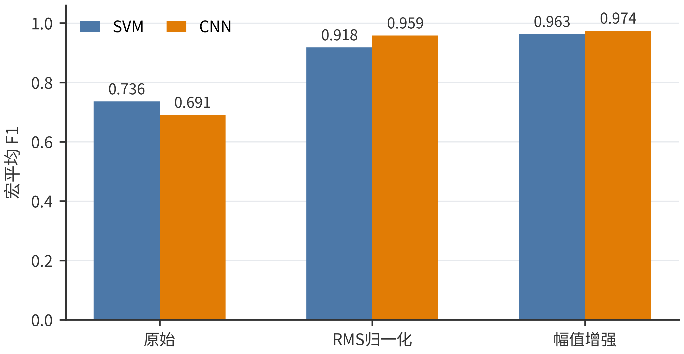
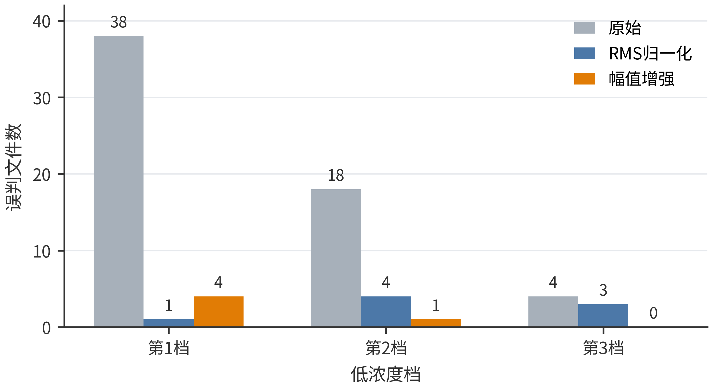
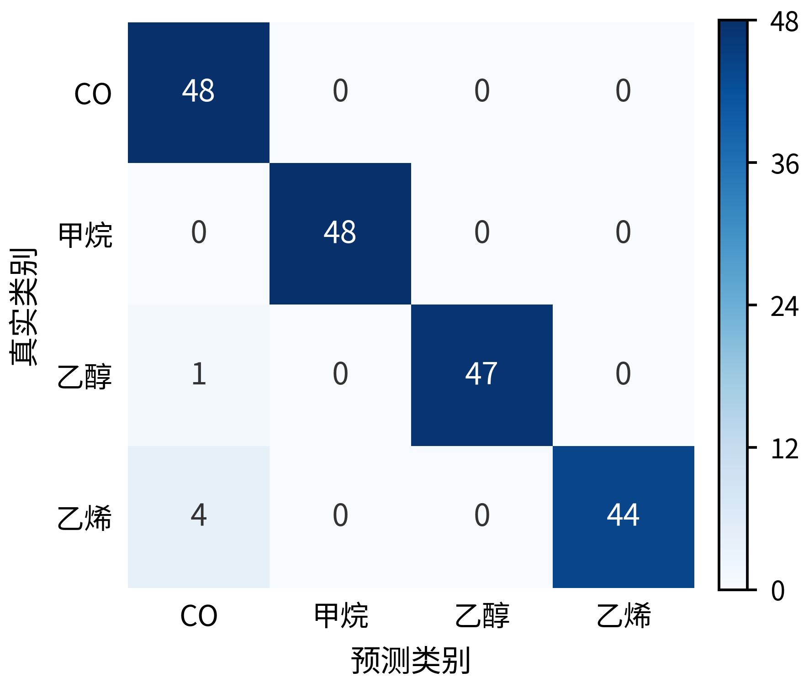
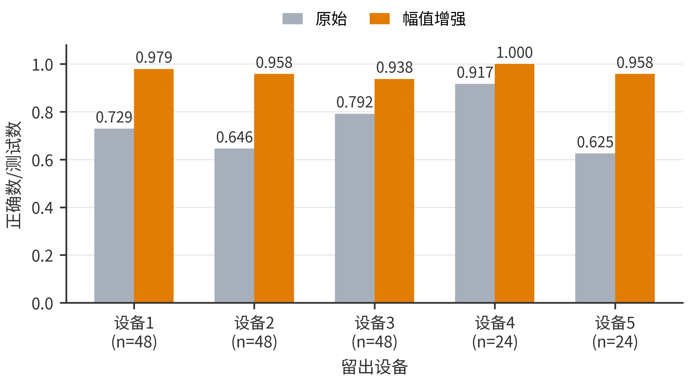

# 面向山西焦化园区的跨设备低浓度气体识别方法

作者姓名¹，作者姓名¹，指导教师¹\*

（1. 山西科技学院光机电工程学院，山西 晋城 048000）

**摘　要：** 焦化园区气体监测设备更换后，新设备与原设备之间的响应差异会使已有识别模型失效；当待测气体浓度又低于训练数据范围时，这一问题更加明显。针对这种情况，设计了一种分级幅值缩放增强方法。先从气敏阵列的八通道数据中提取供气前后的对数响应差，再将源设备的高浓度训练信号分别缩放为原幅值的0.50、0.75和1.00倍，使训练数据覆盖较弱响应。以五台同构设备采集的CO、甲烷、乙醇和乙烯数据为对象，采用整台设备轮流留出的方式，用其他设备的第4—10浓度档训练，识别留出设备的第1—3浓度档。结果表明，幅值增强后，SVM的宏平均F1由0.736提高到0.963，一维CNN的宏平均F1由0.691提高到0.974；增强CNN在192次测试中正确识别187次，其中48次CO全部识别正确。与逐试次归一化、平滑噪声和时间平移相比，该方法在保持CO召回率的同时取得了更高的四类气体识别结果。研究可为焦化园区气体监测设备更换后的模型复用提供参考。

**关键词：** 山西焦化园区；气敏阵列；跨设备识别；低浓度气体；数据增强

**中图分类号：** TP391.4；X936　　**文献标识码：** A

## Cross-device Low-concentration Gas Recognition for Shanxi Coking Industrial Parks

AUTHOR Name¹, AUTHOR Name¹, SUPERVISOR Name¹\*

(1. School of Opto-electronic and Mechanical Engineering, Shanxi Institute of Science and Technology, Jincheng 048000, China)

**Abstract:** When a gas-monitoring device is replaced, the response difference between devices may reduce the performance of an existing recognition model. The problem becomes more serious when the gas concentration measured by the new device is lower than that used for training. A graded amplitude-scaling augmentation method is designed for this condition. Log-response differences are extracted from eight sensor channels, and the high-concentration responses of source devices are scaled by 0.50, 0.75 and 1.00 during training. Five homogeneous devices and four gases, including carbon monoxide, methane, ethanol and ethylene, are used for evaluation. In each fold, four devices at concentration levels 4–10 are used for training, while levels 1–3 of the held-out device are used for testing. The macro-F1 scores of SVM and one-dimensional CNN increase from 0.736 to 0.963 and from 0.691 to 0.974, respectively. The augmented CNN correctly recognizes 187 of 192 tests, including all 48 CO tests. The method provides a lightweight way to reuse gas-recognition models after device replacement.

**Key words:** Shanxi coking industrial park; gas sensor array; cross-device recognition; low-concentration gas; data augmentation

## 0　引言

焦化生产涉及煤气输送、焦炉加热和化产回收等环节，CO、甲烷等气体的连续监测是安全管理的重要组成部分。《焦化安全规范》对气体泄漏监测和作业安全提出了要求[1]，《作业场所环境气体检测报警仪器通用技术要求》也对检测仪器的性能、校准和使用作出规定[2]。在实际使用中，同型号气敏元件的初始电阻和灵敏度并不完全一致，设备长期运行后还会出现老化和漂移。因此，用一台设备采集的数据训练出的模型，直接换到另一台设备上时，识别结果往往会下降。

电子鼻利用多个气敏元件对气体的交叉响应完成分类，常用方法包括支持向量机、神经网络和卷积神经网络等[3-5]。李鹏等[4]利用一维CNN识别甲烷、CO、乙烯及其混合物；吴青云等[5]比较了CNN和BP网络在电子鼻分类中的表现；俞凌伟等[6]采用膨胀因果卷积和注意力机制提取动态响应特征。相洪涛等[14]从动态响应中同时完成气体识别与浓度估计，张辰洋等[15]则把多通道MOS阵列与深度学习模型结合。上述研究说明，深度网络能够从气敏时序中学习有效特征，但多数实验把同一设备、相近浓度的数据同时用于训练和测试，没有单独考察“设备变化”和“浓度降低”同时出现的情况。

针对设备差异，已有研究采用直接标准化、领域适应和全局标定等方法进行校准传递[7-9]，也有研究利用循环温度运行和数据增强缩短传感器标定时间[13]。这些方法通常需要目标设备的配气样本或无标签数据。对于刚投入使用的新设备，如果暂时不能进行完整配气标定，模型仍需要仅凭已有设备的数据完成初始识别。本文据此设置了一个更接近这种使用过程的任务：只用其他设备的较高浓度数据训练，直接识别新设备上的较低浓度气体。

低浓度信号最直接的变化是响应幅度减小。本文不改动分类器结构，而是在训练阶段把源设备响应按三个幅值缩放，形成由强到弱的同类样本。实验同时使用SVM和一维CNN，并与归一化、噪声增强和时间平移进行比较，以判断性能变化主要来自分类器还是数据处理。

## 1　数据与实验任务

### 1.1　数据来源

主实验采用UCI公开的Twin gas sensor arrays数据集[10]。数据由5台结构相同的电子鼻设备采集，每台设备包含8个金属氧化物气敏通道。气体种类为CO、甲烷、乙醇和乙烯，每类气体设10个浓度档。一个原始文件记录一次完整供气过程，共核对得到640个有效文件。

CO和甲烷的第1—3档分别为25、50和75 ppm，第4—10档为100～250 ppm；乙醇和乙烯的第1—3档分别为12.5、25和37.5 ppm，第4—10档为50～125 ppm。由于四种气体的浓度范围不同，本文按各自的档位划分高、低浓度，而不是使用统一的ppm界限。

另外选用UCI 270和UCI 487作压力测试，但两者的数据结构与主实验并不相同。UCI 270在2008年1月至2011年2月的36个月内，用同一套16通道气敏阵列采集了13 910次完整测量，并整理为10个时间批次[11]。气体包括乙醇、乙烯、氨气、乙醛、丙酮和甲苯，浓度范围因气体而异；每次测量已经被处理为128维特征，即每只传感器的2个稳态特征和6个瞬态特征。因此，该数据能够检验浓度下降与长期漂移同时存在时幅值增强是否仍有作用，但没有CO，也没有多台完整设备，不能复现主实验的“换设备后识别低浓度CO”任务。

UCI 487来自气室中的CO与湿空气动态配气实验[12]。平台包含7只TGS 3870-A04和7只SB-500-12传感器，连续记录CO浓度、相对湿度、温度、加热电压和14路电阻。实验在13个工作日重复进行，每日含0～20 ppm的10个CO浓度、每个浓度10次，共100个15 min配气段；相对湿度在15%～75%范围内随机变化，加热器按20 s和25 s周期调制。本文只把同型号的7只SB-500-12看作7个传感器副本，训练使用前10日的0 ppm及6.67～20 ppm段，测试使用后3日的0、2.22和4.44 ppm段。它可以检查跨传感器、跨日期的低浓度CO有无识别，但任务是CO/无CO二分类，没有甲烷、乙醇和乙烯等气体类别，且湿度、日期和加热相位会同时改变响应。

**表1　实验数据及其用途**

| 数据 | 原始内容 | 本文划分 | 与主任务的关系 |
|---|---|---|---|
| UCI 361 Twin | 5台设备、每台8通道；4类气体、10个浓度档、640次供气 | 其他设备第4～10档训练，留出设备第1～3档测试 | 主实验，同时包含换设备、降浓度和四气体识别 |
| UCI 270 | 1套16通道阵列；6类气体、10个时间批次、13 910次测量 | 批次1～5的高浓度训练，批次6～10的低浓度测试 | 检查长期漂移；无CO、无多设备、只有预提取特征 |
| UCI 487 | 14只温度调制传感器；13日、1 300个配气段、约409.5万行 | 7只同型号传感器轮流留出，前10日高浓度训练、后3日低浓度测试 | 检查跨传感器低浓度CO；只有CO/无CO，湿度和加热周期同时变化 |

### 1.2　训练与测试划分

主实验采用留一设备法。每次选1台设备作为测试设备，其余4台作为训练设备。训练集只取第4—10档，测试集只取留出设备的第1—3档。轮换5次后，共得到192个互不重复的低浓度测试文件，其中4类气体各48次。设备1—3各提供48次测试，设备4和设备5各提供24次测试。

这种划分有两个特点：一是测试设备的任何气体标签不进入训练过程；二是训练和测试的浓度范围不重叠。因此，模型必须同时面对设备差异和低浓度响应减弱。

## 2　气体响应处理与识别方法

### 2.1　响应时序提取

原始文件记录8个通道随时间变化的电阻。对第$j$个通道，先取25～45 s内对数电阻的中位数作为供气前基线，再把50～90 s划分为20个相邻的2 s窗口。第$t$个窗口的响应为

$$
x_j(t)=\operatorname{median}_{u\in I_t}\log R_j(u)
-\operatorname{median}_{25\leq u<45}\log R_j(u),
\quad j=1,2,\ldots,8. \tag{1}
$$

式中，$R_j(u)$为时刻$u$的传感器电阻，$I_t$为第$t$个窗口。每次供气最终得到一个$20\times8$的响应矩阵。采用对数差值后，不同通道的量级差异得到压缩，同时保留了供气后的变化方向和时序形状。

### 2.2　分级幅值缩放增强

当气体浓度降低时，传感器响应通常随之减弱。为使模型在训练时见到较弱响应，对源设备的训练矩阵$X$作如下处理：

$$
X_a=aX,\qquad a\in\{0.50,0.75,1.00\}. \tag{2}
$$

同一矩阵的所有通道和时间点使用相同系数。这样不会改变通道之间的比例和响应曲线形状，只扩大了同一类别在幅值方向上的覆盖范围。缩放仅用于训练集，测试文件保持原始响应。该处理不需要增加传感器，也不会增加模型部署后的计算量。

### 2.3　分类模型与对照方法

SVM采用径向基核，惩罚参数$C=1$，核参数使用`scale`，输入特征由训练集拟合的标准化器处理。一维CNN输入为$20\times8$矩阵，卷积层包含16个长度为3的卷积核，经ReLU激活后，将前、后两个时间段分别作均值池化，最后接4类Softmax输出。网络使用L-BFGS优化，权重衰减系数为0.02，最大迭代次数为400。

为比较不同处理方式，设置以下对照：原始响应不增强；每个文件按自身RMS进行归一化；在训练响应中加入平滑噪声；沿时间轴前后平移一个窗口。平滑噪声和时间平移都保持每个原始样本生成3份训练输入，与幅值增强的样本数相同。

## 3　实验结果与分析

### 3.1　总体识别结果

评价指标采用宏平均F1和正确识别次数。考虑到CO在焦化安全监测中的重要性，另外统计CO识别正确数，以及甲烷、乙醇和乙烯被误判为CO的次数。结果见表2。

**表2　不同方法的跨设备低浓度气体识别结果**

| 模型与处理方法 | 宏平均F1 | 正确识别/次 | CO正确/次 | 其他气体误判为CO/次 |
|---|---:|---:|---:|---:|
| SVM，原始响应 | 0.736 | 141/192 | 48/48 | 24 |
| SVM，RMS归一化 | 0.918 | 176/192 | 40/48 | 5 |
| SVM，幅值增强 | 0.963 | 185/192 | 48/48 | 3 |
| CNN，原始响应 | 0.691 | 132/192 | 48/48 | 36 |
| CNN，RMS归一化 | 0.959 | 184/192 | 42/48 | 1 |
| CNN，平滑噪声增强 | 0.706 | 135/192 | 48/48 | 33 |
| CNN，时间平移增强 | 0.691 | 132/192 | 48/48 | 36 |
| CNN，幅值增强 | **0.974** | **187/192** | **48/48** | 5 |

原始CNN只正确识别132次，宏平均F1为0.691；使用幅值增强后，正确数增加到187次，宏平均F1提高到0.974。SVM也出现相同趋势，说明改进并不依赖CNN结构。平滑噪声和时间平移的结果接近原始CNN，表明仅增加训练样本数量不能获得同样的提升，训练样本是否覆盖弱响应更为关键。

RMS归一化CNN正确识别184次，与幅值增强CNN只相差3次，但两者的错误类型不同。RMS归一化把6次CO判成其他气体，幅值增强没有漏判CO，但多出现4次非CO误报。若系统更重视避免CO漏判，可选用幅值增强；若现场误报代价更高，则需要结合归一化结果或报警复核机制。

图1比较原始输入、RMS归一化和幅值增强在两种模型上的宏平均F1。其余处理方法的完整数值保留在表2。两种模型使用幅值增强后均有提高；CNN的幅值增强结果与RMS归一化结果接近，不能只看总体F1判断两者在CO上的表现。

**图1　SVM与CNN在192个测试文件上的宏平均F1比较**

### 3.2　不同气体的识别情况

图2按浓度档统计CNN的误判次数，每档有64个测试文件。原始CNN在第1档误判38次，第2档误判18次；幅值增强后分别降为4次和1次，第3档没有误判。RMS归一化在第1档误判更少，但另外两个档位仍有错误。幅值增强的主要收益出现在前两个弱响应档位。

**图2　CNN在三个低浓度档位上的误判次数（每档64个测试文件）**

图3给出幅值增强CNN的四类气体混淆矩阵。原始CNN能识别全部48次CO，但把12次乙醇和24次乙烯判成CO，另有20次甲烷被判为乙烯。幅值增强后，CO和甲烷均正确48次，乙醇正确47次，乙烯正确44次；仍有5次非CO被判为CO。因此，CO召回率和误报次数应同时报告。

**图3　幅值增强CNN的四类气体混淆矩阵（每类48个测试文件）**

### 3.3　不同设备上的识别结果

图4比较了SVM在5台留出设备上的正确数与测试数之比。原始SVM在设备1—5上的结果分别为0.729、0.646、0.792、0.917和0.625；幅值增强后分别为0.979、0.958、0.938、1.000和0.958。5台设备均有提升，其中设备2和设备5的变化较大。设备1—3各有48个测试文件，设备4和设备5各有24个，图中的一个点代表一台物理设备。

**图4　五台留出设备上SVM的分类结果比较**

CNN结果中也存在差异。幅值增强CNN在设备1和设备2上的宏平均F1分别为0.939和0.958，在设备3—5上均为1.000。RMS归一化CNN在设备2上达到1.000，高于幅值增强CNN，说明设备差异较小时，直接去除幅值也可能更合适。因此，幅值增强适合作为默认训练处理，但不应代替设备上线后的基本标定。

### 3.4　少量目标设备标定的影响

进一步从每台测试设备的高浓度数据中按4类气体各取5次，共20次，加入训练集。3次不同抽样的结果见表3。

**表3　加入20次目标设备标定数据后的SVM结果**

| 训练方式 | 宏平均F1 | 正确识别/次 |
|---|---:|---:|
| 源设备幅值增强，不用目标标定 | 0.963 | 185/192 |
| 源设备＋目标20次，不增强 | 0.739～0.745 | 142～143/192 |
| 源设备＋目标20次＋幅值增强 | **0.968～0.990** | **186～190/192** |
| 仅用目标20次＋幅值增强 | 0.876～0.943 | 168～181/192 |

只加入20次目标设备数据而不处理低浓度响应，结果没有明显改善；把目标样本与幅值增强结合后，正确数达到186～190次。这说明少量标定和幅值增强并不冲突：前者补充设备差异，后者补充浓度范围，两者同时使用效果更好。

### 3.5　不同公开数据上的结果

表4列出了另外两套数据上的结果。UCI 270中，本文用批次1～5中各气体浓度位于源域上三分位的1 352次测量训练，用批次6～10中浓度位于源域下三分位的5 329次测量测试。幅值增强SVM的宏平均F1由0.225提高到0.452，并在5个测试批次上均优于原始SVM，但绝对识别结果仍然偏低。原因是训练和测试不仅浓度不同，还跨越了约20个月以上的传感器老化过程；数据给出的又是128维人工特征，而非可按本文40 s窗口重新提取的原始八通道时序。幅值缩放只能补充响应强弱，不能校正各通道随时间发生的非一致漂移。因此，UCI 270支持“增强方向有帮助”，但不适合作为跨设备低浓度CO的同任务复现。

UCI 487中，每个15 min配气段分别提取加热器高、低电压阶段的对数电阻中位数，并减去当日洁净空气基线；7只SB-500-12传感器轮流留出，前10日训练、后3日测试，共形成21个“留出传感器—测试日”评价块。幅值增强SVM的平均宏F1由0.529提高到0.593，其中15块提高、5块不变、1块下降，但CO平均召回率只有0.512。该数据与主实验不完全适配，主要不是数据质量差，而是它把低浓度CO与随机湿度、跨日漂移和周期加热耦合在一起；同时只提供CO与空气，无法检查其他气体被误报为CO的情况。固定幅值缩放没有显式使用湿度和加热相位补偿，所以只能取得有限改善，不能把该结果解释为四气体方法失败或成功。

**表4　不同公开数据上的幅值增强结果**

| 数据与任务 | 原始SVM宏平均F1 | 幅值增强SVM宏平均F1 | 结果 |
|---|---:|---:|---|
| Twin：5台设备、4类气体 | 0.736 | **0.963** | 5台设备均提高 |
| UCI 270：跨批次6类气体 | 0.225 | **0.452** | 5个测试批次均提高，绝对结果偏低 |
| UCI 487：跨器件低浓度CO | 0.529 | **0.593** | 15/21个组合提高，CO召回率偏低 |

表4同时列出增强前后的绝对分数，以免只看增量而忽视UCI 270和UCI 487的低分。三套数据没有被拼接训练，也没有计算跨数据集总准确率。UCI 270检验长期漂移下的六气体分类，UCI 487检验湿度和加热变化下的CO二分类，只有UCI 361同时具备多台完整设备、四种气体和明确的高低浓度档。UCI 487中仍有1个评价块下降，因此两套补充数据用于说明方法的适用边界，而不是重复主实验结论。

## 4　结语

针对气体识别模型换设备后难以识别低浓度信号的问题，本文采用分级幅值缩放扩充源设备训练数据，并在整台设备留出的条件下进行验证。主实验中，SVM和一维CNN的宏平均F1分别提高到0.963和0.974，增强CNN正确识别187/192次，48次CO均未漏判。与噪声增强、时间平移和RMS归一化的对比表明，补充弱幅值响应是本任务性能提高的主要原因。

该方法只改变训练数据，不增加部署端计算量，适合已有同型号设备历史数据、但新设备标定样本较少的情况。其不足是没有直接处理湿度、长期漂移和复杂混合气干扰。下一步应在保持设备留出和高、低浓度分离的前提下，增加温湿度变化及干扰气体试验，并根据实际报警需求进一步平衡CO漏报与误报。

## 参考文献

[1] 国家市场监督管理总局, 国家标准化管理委员会. GB 12710—2024 焦化安全规范[S]. 北京: 中国标准出版社, 2024.

[2] 国家市场监督管理总局, 国家标准化管理委员会. GB 12358—2024 作业场所环境气体检测报警仪器通用技术要求[S]. 北京: 中国标准出版社, 2024.

[3] KARAKAYA D, ULUCAN O, TURKAN M. Electronic nose and its applications: A survey[J]. International Journal of Automation and Computing, 2020, 17(2): 179-209.

[4] 李鹏, 徐永凯, 杨佳康, 等. 基于一维卷积神经网络的气体识别方法研究[J]. 电子器件, 2022, 45(3): 645-650.

[5] 吴青云, 邹亚囡, 史雪莹. 基于卷积神经网络的电子鼻分类识别[J]. 吉林化工学院学报, 2022, 39(11): 38-41.

[6] 俞凌伟, 杨孟平, 杨海, 等. 基于膨胀因果卷积和注意力机制的气体识别方法[J]. 华东理工大学学报(自然科学版), 2025, 51(3): 380-390.

[7] FONOLLOSA J, FERNÁNDEZ L, GUTIÉRREZ-GÁLVEZ A, et al. Calibration transfer and drift counteraction in chemical sensor arrays using Direct Standardization[J]. Sensors and Actuators B: Chemical, 2016, 236: 1044-1053.

[8] PAN X, CHEN J, WEN X, et al. A comprehensive gas recognition algorithm with label-free drift compensation based on domain adversarial network[J]. Sensors and Actuators B: Chemical, 2023, 387: 133709.

[9] MIQUEL-IBARZ A, BURGUÉS J, MARCO S. Global calibration models for temperature-modulated metal oxide gas sensors: A strategy to reduce calibration costs[J]. Sensors and Actuators B: Chemical, 2022, 350: 130769.

[10] FONOLLOSA J. Twin gas sensor arrays[DS]. UCI Machine Learning Repository, 2016.

[11] FONOLLOSA J, RODRÍGUEZ-LUJÁN I, HUERTA R. Chemical gas sensor array dataset[J]. Data in Brief, 2015, 3: 85-89.

[12] BURGUÉS J. Gas sensor array temperature modulation[DS]. UCI Machine Learning Repository, 2018.

[13] ZHANG S, et al. Strategy to expedite gas sensor calibration based on cyclic temperature operation and data augmentation[J]. Sensors and Actuators B: Chemical, 2024, 416: 136060.

[14] 相洪涛, 张文文, 肖文鑫, 等. 仿生嗅觉感知系统气体识别和浓度估计模型[J]. 自动化学报, 2024, 50(4): 812-827.

[15] 张辰洋, 刘广顺, 马鹏飞, 等. 基于深度学习的多通道MOS环境气体检测系统[J]. 计测技术, 2025, 45(5): 97-107.
